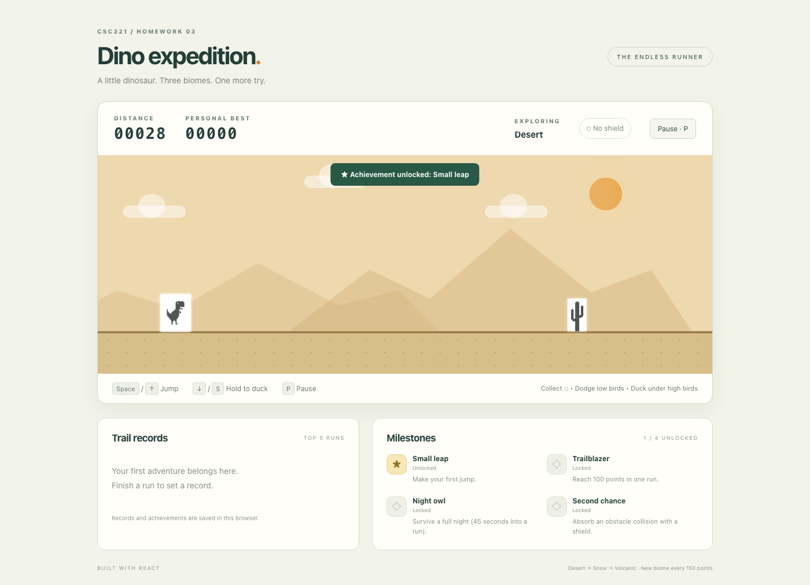

# Dino Game — CSC321 Homework 3

This is my CSC321 Homework 3 Dino game, built from the provided React starter. It keeps the starter's `App` and `Dino` component structure and turns the original runner into a longer game with obstacles, changing scenery, saved scores, and achievements.

## Added features

1. **Shield power-up:** A turquoise hexagon appears during a run. Collecting it gives the dinosaur a shield that absorbs one obstacle collision. After a hit, the shield is removed and the dinosaur is briefly invulnerable.

2. **Ducking and flying obstacles:** The game adds low and high birds alongside the cactus obstacles. Holding the duck key lowers the dinosaur's collision box so it can pass under high birds. Cacti and low birds can be cleared by jumping.

3. **Changing biomes:** The background begins in the Desert, changes to Snow at 150 points, and changes to Volcanic at 300 points. The sequence repeats every 450 points, and each biome changes the ground, mountains, cactus, and bird colors.

4. **Day and night cycle:** The sky gradually changes as the run continues. The sun fades out, the moon and stars appear, and moving clouds remain in the scene. One complete cycle takes 45 seconds.

5. **Local leaderboard:** When a run ends, its score and date are recorded. The game sorts completed runs by score, displays the five highest results, and uses the highest one as the personal best.

6. **Achievements:** Four achievements track the first jump, reaching 100 points, surviving for 45 seconds, and using a shield to absorb a collision. A notification appears when an achievement is unlocked.

## Controls

- `Space` or `Arrow Up`: start the game and jump
- Hold `Arrow Down` or `S`: duck; release the key to stand
- `P`: pause or resume the game

The on-screen buttons can also start, restart, pause, and resume a run. Moving away from the browser window automatically pauses an active game.

## Setup and running the game

Install the project dependencies:

```sh
npm install
```

Start the development server:

```sh
npm start
```

The game opens at `http://localhost:3000` by default.

To create a production build, run:

```sh
npm run build
```

The generated files are placed in the `build/` directory.

## Saved progress and credits

The leaderboard and unlocked achievements are saved in the browser's local storage under the key `csc321-dino-v1`. This progress stays available after a page refresh in the same browser. If local storage is unavailable or contains invalid data, progress is kept only for the current session until it can be saved again.

The `trex.png` and `cactus.png` images were included with the professor's starter project; no original artist or license information was provided. The React icons in `public/` come from the Create React App starter. The birds, shield, and scenery are drawn with CSS and text symbols.


